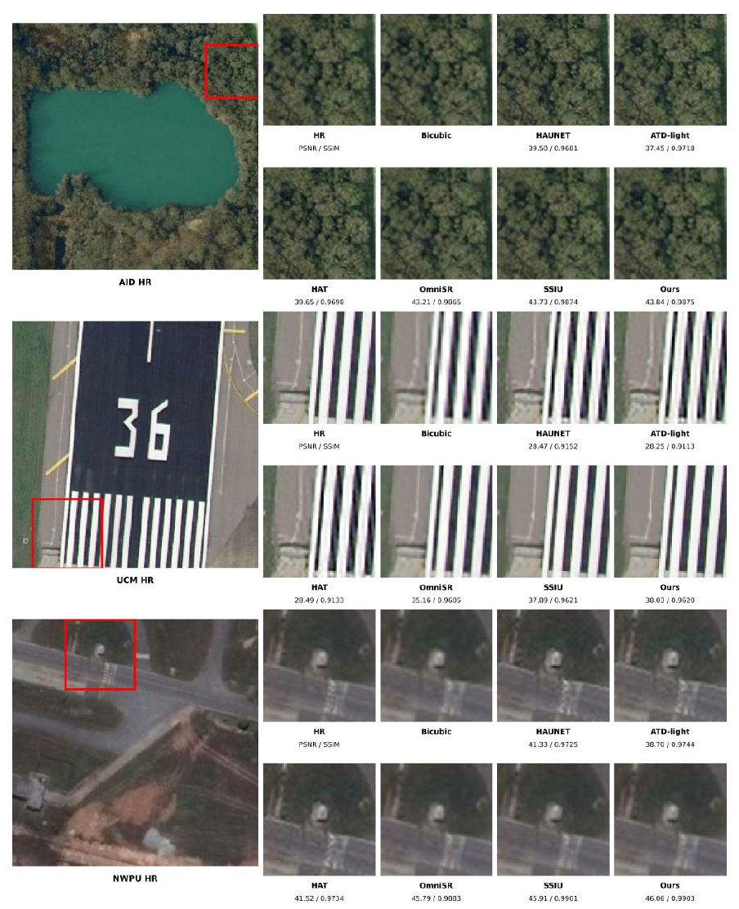
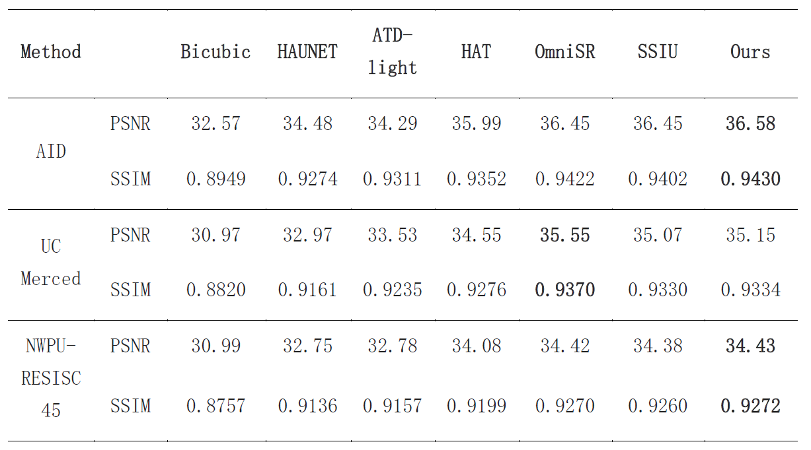

# DUSFNet

DUSFNet is a model for remote sensing image super-resolution. It is improved from the SSIU baseline model and is designed to enhance the reconstruction quality of high-resolution remote sensing images.

**Source code coming soon.**

## Experimental Results

### Subjective Visual Comparison

### Quantitative Comparison

